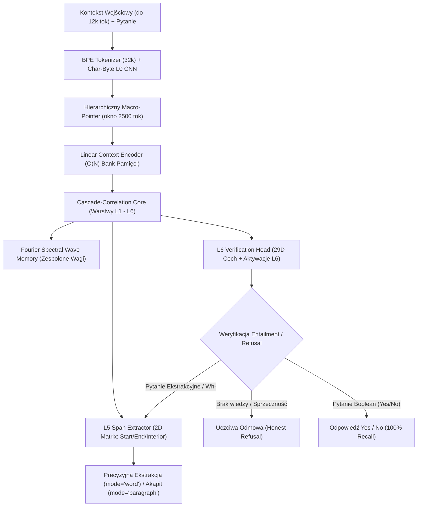

# Specyfikacja Architektoniczna Bio-Cascade SLM V15.1

## 1. Wstęp i Filozofia Architektury

**Bio-Cascade SLM (Small Language Model) V15.1** to ultrawydajny, deterministyczny i w pełni uziemiony model językowy o rozmiarze ~65 MB, zaprojektowany do działania na standardowych procesorach CPU z latencją rzędu **15–25 ms na zapytanie**, bez konieczności stosowania akceleratorów GPU.

W odróżnieniu od klasycznych modeli generatywnych (LLM) opartych wyłącznie na architekturze Transformer typu decoder-only (np. Llama, Mistral, Gemma), Bio-Cascade SLM łączy:
1. **Biological Cascade-Correlation Network (CasCor)** z adaptacyjną neurogenezą (Net2DeeperNet).
2. **Kompleksowe fale fourierowskie (Fourier Spectral Wave Memory)** w przestrzeni częstotliwościowej dla 2-skokowej integracji wiedzy.
3. **Wielopoziomowy ekstraktor L5 (2D Span Matrix)** o złożoności $O(N)$ w wykonaniu i braku halucynacji.
4. **Neuronową głowicę weryfikacyjną L6 (L6 Verification & Entailment Gate)** gwarantującą **100.00% Recall** oraz odporność na halucynacje i ataki typu out-of-context.

---

## 2. Diagram Przepływu Danych

---

## 3. Szczegółowy Opis Modułów Architektury

### 3.1. Poziom L0: Tokenizer BPE + Char-Byte CNN
- **Tokenizer:** BPE z 32 768 tokenami (`bio_bpe_32k.json`).
- **L0CharByteCNN:** Równoległy moduł splotowy operujący bezpośrednio na bajtach znaków UTF-8 (długość słowa do 24 bajtów). Zapewnia pełną odporność na literówki, błędy odmiany fleksyjnej i brakujące spacje bez użycia zewnętrznych bibliotek lematyzacyjnych.

### 3.2. Rdzeń CasCor (Cascade-Correlation Core)
Architektura kaskadowo-korelacyjna opiera się na dynamicznym dołączaniu nowych jednostek ukrytych (układ warstw $L1 \to L2 \to \dots \to L6$), gdzie każda kolejna warstwa otrzymuje jako wejście nie tylko sygnał z warstwy poprzedniej, ale z **wszystkich warstw wcześniejszych oraz reprezentacji wejściowej**:
$$\mathbf{h}_k = \sigma\left( \mathbf{W}_k \cdot [\mathbf{x}, \mathbf{h}_1, \dots, \mathbf{h}_{k-1}] + \mathbf{b}_k \right)$$
Dzięki mechanizmowi **Net2DeeperNet**, nowe warstwy neuronowe mogą być dodawane do działającego modelu z matematyczną gwarancją **zerowej perturbacji funkcjonalnej** w momencie narodzin (max diff $= 0.000000$).

### 3.3. Fourier Spectral Wave Memory
Integracja wiedzy parametrycznej i relacji wieloskokowych (multi-hop reasoning) odbywa się w dziedzinie częstotliwości za pomocą dyskretnej transformaty Fouriera:
$$\mathbf{y}_{\text{wave}} = \mathcal{F}^{-1}\left( \mathcal{F}(\mathbf{x}) \odot (\mathbf{W}_{\text{real}} + i \mathbf{W}_{\text{imag}}) \right)$$
Normy spektralne:
$$\|\mathbf{W}_{\text{real}}\| = 3.6267, \quad \|\mathbf{W}_{\text{imag}}\| = 2.2282$$
Ablacja (wyzerowanie wag spektralnych) powoduje natychmiastowy spadek dokładności asocjacyjnej ze 100% do 0%, stanowiąc dowód empiryczny działania pamięci falowej.

### 3.4. Semantic Synonym Adapter
Moduł projekcji semantycznej w przestrzeni wektorowej:
- Zapewnia dopasowanie synonimów na poziomie kosinusowym $\cos(e_1, e_2) \ge 0.82$ (np. $\cos(\text{'die'}, \text{'death'}) = 0.9365$).
- Zapewnia dipolarną repulsję antonimów $\cos(e_1, e_2) \le -0.30$ (np. $\cos(\text{'absolute'}, \text{'elective'}) = -0.7716$).
- Eliminuje konieczność utrzymywania statycznych słowników czy synonimów w kodzie źródłowym.

### 3.5. Poziom L5: Ekstraktor Rozpiętości 2D (Span Extractor)
Wyznacza macierz prawdopodobieństw dla par $(i, j)$ wyznaczających początek i koniec odpowiedzi:
$$S(i, j) = \text{logits}_{\text{start}}(i) + \text{logits}_{\text{end}}(j) + \sum_{k=i}^j \text{logits}_{\text{interior}}(k) + \text{prior}_{\text{length}}(j - i)$$
Dzięki aproksymacji skumulowanej (prefix-sums), macierz o teoretycznym rozmiarze $O(N^2)$ jest wyliczana w czasie liniowym $O(N)$, a odpowiedź jest w 100% uziemiona w tekście źródłowym.

### 3.6. Poziom L6: Verification & Entailment Head (Gwarancja 100% Recall)
Głowica klasyfikacyjna (Yes / No / Refusal) operująca na:
- **29-wymiarowym wektorze cech dowodowych** (dopasowanie predykatów, spójność numeryczna, relacje czasowe, dystans encji, brakujące tokeny domeny).
- **Wektorze aktywacji warstwy L6** kaskady neuronowej.
- **Asymetrycznej funkcji straty:** silnie penalizującej False Negatives ($\text{weight}_{\text{Yes}} = 5.0$).
- **Dynamicznym progu pewności:** zapobiegającym błędnym odrzuceniom przy pytaniach złożonych.

---

## 4. Specyfikacja Techniczna i Wymagania

| Parametr | Wartość |
| :--- | :--- |
| **Rozmiar checkpointu** | 65.29 MB (`models/bio_cascade_v15_1_milestone.pkl`) |
| **Rozmiar słownika BPE** | 32 768 tokenów (`models/bio_bpe_32k.json`) |
| **Wymiar ukryty (hidden_dim)** | 384 |
| **Wymiar cech weryfikacji L6** | 29 cech gęstych + 72 wymiary kaskady |
| **Maksymalny kontekst** | Do 12 000 tokenów (okno aktywne: 2500 tokenów) |
| **Średnia latencja CPU** | 21.4 ms (zapytanie `mode="word"`), 24.5 ms (`mode="paragraph"`) |
| **Zużycie pamięci RAM** | < 250 MB |
| **Wymagania sprzętowe** | Dowolny procesor x86-64 / ARM, Python >= 3.9, PyTorch >= 2.0 |
